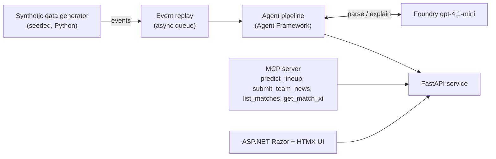
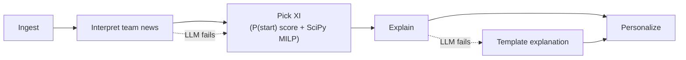
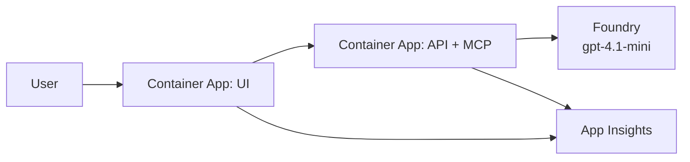

# Architecture

Lineup Oracle predicts a club's starting XI before kick-off. It replays synthetic match and team-news events through a Microsoft Agent Framework pipeline, picks the XI with deterministic code, and uses an LLM only to parse team news and explain the pick.

This file holds the system picture and the contracts between components. Implementation detail lives in each OpenSpec change's `design.md`. Working plan, deadlines and tool allocation are in [PLAN.md](PLAN.md). Any change that alters a contract or component updates this file in the same PR.

Status key: **stable** (built or fixed), **draft** (agreed shape, will change when its OpenSpec change is proposed), **planned** (not built).

## System context

All data is synthetic: invented clubs and players, no crests, logos or photos.

## Pipeline

- **Deterministic:** P(start) is a transparent weighted score, with no trained model. The MILP runs once per formation, weighted by the club's formation prior.
- **LLM:** only parses free-text team news and writes explanations. If it fails, the XI is still returned, with a template explanation.
- **Team news has two input paths.** Structured events (UI preset buttons) skip the LLM and go straight to availability. Free-text news (generated, or typed in the UI) goes through the LLM parser, which outputs the same structured availability. If the parse fails or names an unknown player, the news is rejected with a message and the XI is unchanged.

## Azure deployment (planned)

Telemetry uses OpenTelemetry only: the API and UI use the standard instrumentation, the pipeline uses the Agent Framework's built-in traces, and everything exports to App Insights through the Azure Monitor OpenTelemetry distro. No custom telemetry or dashboards. The traces show per-stage timing and LLM failures with the template fallback serving the XI.

Bicep, secrets in Container Apps secrets, managed identity where possible. Model deployment name comes from an environment variable.

## Contracts

### Event schema (stable)

One flat JSON object per event, JSON Lines on disk:

| Field | Type | Notes |
|---|---|---|
| `id` | string | unique |
| `match_id` | string | |
| `type` | string | pass, shot, tackle, possession_change, pressure, team_news (injury, suspension, late fitness doubt), match_metadata |
| `minute` | float | match minute; team news uses offsets before kick-off |
| `club` | string | |
| `player` | string or null | null for non-player events |
| `payload` | object | type-specific |
| `simulated` | bool | always true |

Generated team-news events are free text in `payload.text` (naming the club and player, with `player` null), so the LLM parser must read them. The payload also carries `kind` and `player_name` as answer labels for the parser eval; the parser must not read them. Events with structured fields only (UI preset buttons) skip the LLM. The structured truth is the true XI in the match metadata.

Match metadata records the actual starting XI and formation of both clubs, `payload.matchday` (1 to 10) and `payload.schema_version` (1). Event minutes are relative to each match's kick-off, so replay one match at a time. Source: `openspec/changes/synthetic-data-and-replay/design.md`.

### `predict_lineup` (draft)

Request: club, fixture, mode (analyst or fan), language (en, es, zh-Hant).
Response: formation; 11 players each with position slot, `p_start` and explanation; alternatives per slot; `llm_used` flag (false when the template fallback ran).

### `submit_team_news` (draft)

The UI offers two controls: a preset button that sends a structured event (player, kind), and a free-text box that sends `text` for the LLM to parse. Generated news arrives through replay as text. All three go through the API, which feeds the event into the pipeline and returns the updated lineup, or a rejection message for unparseable free text.

### MCP server (draft)

A thin adapter over the FastAPI service with no logic of its own. Tools: `predict_lineup`, `submit_team_news` (same contracts as above), `list_matches` and `get_match_xi` (read-only). Any MCP client, such as GitHub Copilot or Claude Desktop, can run the whole flow: submit free-text team news, then read the new XI and explanation. The agent pipeline does not call MCP. It is the first thing cut after Azure polish if time runs short.

### Pipeline stages (draft)

| Stage | In | Out |
|---|---|---|
| Ingest | replayed events | events grouped by match |
| Interpret | structured team-news events, or free-text news via the LLM parser | availability per player (or rejection) |
| Pick XI | availability, roster, form | formation + 11 players with `p_start` |
| Explain | picked XI | explanation per player |
| Personalize | explanations, mode, language, favourite club | final response |

## Evaluation

Correct starters out of 11 versus a "same XI as last match" baseline, on held-out synthetic matches. It shows the pipeline works, not real-world accuracy.

## Open decisions

- **Event Hubs instead of the in-process queue:** cut unless time allows. Owner: user. Decide by Oct 25 feature freeze.
- **Persistence:** none. Roster and events are files; prediction history, if needed, is in memory or SQLite. Postgres was cut (decided Oct 20).
- **Formation-to-MILP mapping and formation priors:** defined in the optimizer change (change 2).
- **Theme fit of a pre-match predictor:** decided not to ask the sponsor; accepted risk.
