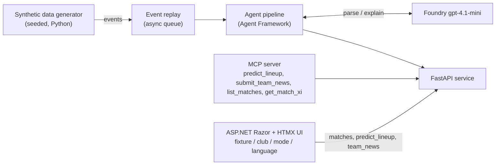
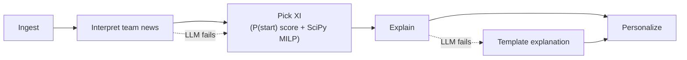
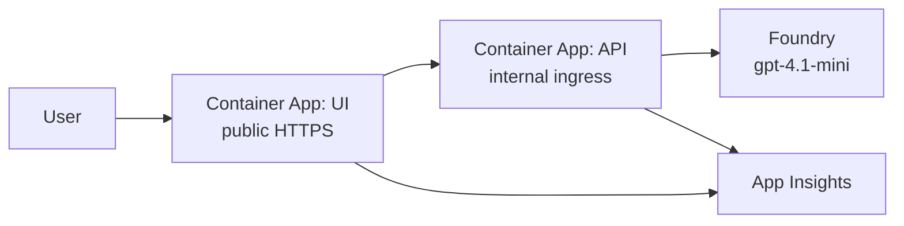

# Architecture

Lineup Oracle predicts a club's starting XI before kick-off. It replays synthetic match and team-news events through a Microsoft Agent Framework pipeline, picks the XI with deterministic code, and uses an LLM only to parse team news and explain the pick.

This file holds the system picture and the contracts between components. Implementation detail lives in each OpenSpec change's `design.md`. Working plan, deadlines and tool allocation are in [PLAN.md](PLAN.md). Any change that alters a contract or component updates this file in the same PR.

Status key: **stable** (built or fixed), **draft** (agreed shape, will change when its OpenSpec change is proposed), **planned** (not built).

## System context



All data is synthetic: invented clubs and players, no crests, logos or photos.

## Pipeline



- **Deterministic:** P(start) is a transparent weighted score, with no trained model: `availability × (0.7 × quality + 0.3 × share of the last 5 matches started)`, where availability is 1 (available), 0.5 (doubt) or 0 (out). The MILP runs once per formation, weighted by the club's formation prior (1.0 for its usual formation, 0.85 for any other), and the best weighted total wins. Ties go to the lower player id.
- **LLM:** only parses free-text team news and writes explanations. If it fails, the XI is still returned, with a template explanation.
- **Team news has two input paths.** Structured events (UI preset buttons) skip the LLM and go straight to availability. Free-text news (generated, or typed in the UI) goes through the LLM parser, which outputs the same structured availability. If the parse fails or names an unknown player, the news is rejected with a message and the XI is unchanged.

## Azure deployment (built, not yet deployed live)



Defined in `infra/` (`main.bicep`, `containerApp.bicep`, `main.bicepparam`) and deployed by `infra/deploy.ps1`; images are built in Azure Container Registry from `backend/Dockerfile` and `ui/Dockerfile`. CI (`.github/workflows/ci.yml`) runs `pytest`, `dotnet test` and a Bicep compile; there is no deploy job.

- **Ingress:** only the UI is public (HTTPS). The API has internal ingress, reachable inside the Container Apps environment only; the UI reaches it through `LineupApi__BaseUrl`. Both run one replica, because team news and anti-forgery keys are in memory.
- **Identity and secrets:** one user-assigned managed identity, shared by both apps, holds `AcrPull` on the registry and `Cognitive Services OpenAI User` on the Foundry account. The API reaches the model with `DefaultAzureCredential` (`AZURE_CLIENT_ID` selects the identity), so there is no model key and `LINEUP_LLM_API_KEY` is never set. Nothing needs storing as a Container Apps secret. The Foundry account has local (key) auth disabled.
- **Model settings:** `LINEUP_LLM_ENDPOINT` and `LINEUP_LLM_DEPLOYMENT` come from the Bicep outputs. Without Foundry quota, `existingLlmEndpoint` and `existingLlmDeployment` point at a model you already have. If the model is missing or fails, the API still serves XIs with template explanations.
- **MCP:** the MCP adapter is a stdio process and is not hosted. Run it locally with `LINEUP_API_URL` pointing at an API.
- **Telemetry:** OpenTelemetry only, exported through the Azure Monitor distro (`azure-monitor-opentelemetry` in the API, `Azure.Monitor.OpenTelemetry.AspNetCore` in the UI), switched on only when `APPLICATIONINSIGHTS_CONNECTION_STRING` is set (the deployment sets it). The API also calls `agent_framework.observability.enable_instrumentation()`, so the pipeline's built-in traces are exported; prompts and replies are not captured. The distros instrument FastAPI, httpx and ASP.NET Core, which links the UI request to the API request. The traces show per-stage timing and LLM failures with the template fallback serving the XI. No custom telemetry or dashboards.

## Contracts

### Event schema (stable)

One flat JSON object per event, JSON Lines on disk:

| Field | Type | Notes |
|---|---|---|
| `id` | string | unique |
| `match_id` | string | |
| `type` | string | pass, shot, tackle, possession_change, pressure, team_news (injury, suspension, late fitness doubt), match_metadata |
| `minute` | float | match minute; team news uses offsets before kick-off |
| `club` | string | |
| `player` | string or null | null for non-player events |
| `payload` | object | type-specific |
| `simulated` | bool | always true |

Generated team-news events are free text in `payload.text` (naming the club and player, with `player` null), so the LLM parser must read them. The payload also carries `kind` and `player_name` as answer labels for the parser eval; the parser must not read them. Events with structured fields only (UI preset buttons) skip the LLM. The structured truth is the true XI in the match metadata.

Match metadata records the actual starting XI and formation of both clubs, `payload.matchday` (1 to 10) and `payload.schema_version` (1). Event minutes are relative to each match's kick-off, so replay one match at a time. Source: `openspec/changes/synthetic-data-and-replay/design.md`.

### `predict_lineup` (stable)

`POST /predict_lineup` with `{match_id, club, mode, language, session_id}`. `session_id` is optional (default `"default"`, at most 64 characters): team news is kept per session, so visitors using the same deployment do not see each other's news. The UI sends one id per browser. `mode` is `analyst` or `fan` (default analyst); `language` is `en`, `es` or `zh-Hant` (default en); both are validated and echoed. `language` and `mode` shape only the explanation texts (the XI is the same). The club must play in the match.
Response: `formation`; `players` (11, each with `id`, `name`, `number`, `position`, `p_start`, `explanation`); `alternatives` (up to 2 per position, same player shape); `llm_used` (true when the explanation texts came from the model, one flag per lineup); `mode`; `language`. The prediction uses only the club's XIs from earlier matchdays plus the availability submitted for that match and club, never the match's own XI. Explanations come from the LLM explainer in the requested mode and language; if the model is off, fails or returns something invalid, they are English templates and `llm_used` is false. Fan texts never contain numbers, `%` or "P(start)".
Errors: `{"detail": message}` with 404 for an unknown match and 422 for a club not in the match, a bad mode or language, or when no formation can be filled.

### `submit_team_news` (stable)

`POST /team_news` with the predict fields plus `player_id` and `kind` (`injury`, `suspension` or `doubt`). Injury and suspension mark the player out, doubt marks the player doubt, for that match, club and session only; the latest news for a player wins. The response is the updated `LineupOut` (same shape as `predict_lineup`). The structured path is what the UI preset buttons use. A request with `text` and no player and kind goes to the LLM parser, which must name a player of that club and a kind; the answer is validated by code and then follows the structured path. If the model is off, fails, times out or names an unknown player, the request is rejected with 422 and nothing changes. A player outside the club, an unknown match or a bad kind is rejected with no state change. Availability lives in memory and is lost on restart.

### Read-only operations (stable)

`GET /matches` returns `[{match_id, matchday, home_club, away_club}]` in matchday order. `GET /matches/{match_id}/xi` returns the recorded XI and formation of both clubs (404 for an unknown match). `GET /health` returns `{"status": "ok"}`. Run with `uvicorn lineup_oracle.api:create_app --factory`.

### MCP server (stable)

A thin adapter over the FastAPI service with no logic of its own (`lineup_oracle/mcp_server.py`, stdio transport). Tools: `predict_lineup`, `submit_team_news` (same contracts as above), `list_matches` and `get_match_xi` (read-only). Each tool is one HTTP call to `LINEUP_API_URL` (default `http://127.0.0.1:8000`), and API errors come back as tool errors carrying the API's message. Any MCP client, such as GitHub Copilot or Claude Desktop, can submit structured team news and read the new XI; free text works when the model is configured (otherwise `submit_team_news` returns the API's 422 message). The agent pipeline does not call MCP. It is the first thing cut after Azure polish if time runs short.

### UI (stable)

The ASP.NET Razor Pages + HTMX app is a single page and calls only the FastAPI service. It loads fixtures from `GET /matches`, predicts with `POST /predict_lineup`, and submits preset or typed team news with `POST /team_news`. Preset injury, suspension and doubt updates are supported; typed news goes to the LLM parser when the model is configured, otherwise the API rejects it with 422. Each browser gets a random `session_id`; the UI sends it, the selected mode and language with prediction and news requests. Mode, language and favourite club are presentation preferences stored in cookies. The UI owns presentation only; it does not score players, choose formations, or keep availability state.

Same-page actions that update the current view use HTMX requests and server-rendered HTML fragments by default. This applies to fixture and club selection, favourite-club and language preferences, team-news submissions, and retry. Successful fixture, club, and favourite changes replace the shared workspace and push the selected match and club into browser history; language changes replace the localized application shell. A failed selection keeps the last successful workspace visible and offers retry for the requested selection. While any in-page HTMX request is pending, a shared localized status is shown and politely announced; the existing view remains visible until the response is applied. Its spinner is indeterminate and respects reduced-motion preferences; no completion percentage is shown. Non-HTMX form submissions retain full-page behavior. True document navigation, such as the brand link, and file downloads remain normal browser requests. Future in-page UI features follow this convention.

```text
+--------------------------------------------------------------------------------+
| LINEUP ORACLE                                                Language: [en v] |
| [Updating... status, shown during pending HTMX requests]                          |
| [Service unavailable banner: retry]                                            |
+--------------------------------------+-----------------------------------------+
| FIXTURES                             | LINEUP                                  |
| [Matchday / fixture picker]          | Formation: API value    [Template / AI]|
| [Club toggle: Home | Away] [star]    |                                         |
|                                      | Forwards                                |
| TEAM NEWS                            | [Player card] [Player card] ...         |
| [Free-text news input] [Submit]      | Alternatives: API values                |
| [message / API error]                |                                         |
|                                      | Midfielders                             |
|                                      | [Player cards]                          |
|                                      | Alternatives: API values                |
|                                      |                                         |
|                                      | Defenders                               |
|                                      | [Player cards]                          |
|                                      | Alternatives: API values                |
|                                      |                                         |
|                                      | Goalkeeper                             |
|                                      | [Player card]                           |
|                                      | Alternatives: API values                |
+--------------------------------------+-----------------------------------------+
```

Each player card has text-only name, shirt number, position and explanation, plus preset injury, suspension and doubt buttons. The UI always runs in analyst mode and shows API `p_start` values. The mode switch is hidden to keep the demo simple; the API and `/?mode=fan` still support fan mode, which hides them. The last lineup stays visible when an API error occurs. There are no crests, logos, photos, invented metrics, or panels for data the API does not return.

### Pipeline stages (stable)

Implemented in `lineup_oracle/pipeline.py` (a deterministic orchestrator) with two Microsoft Agent Framework agents in `agents.py` (News Parser, Explainer). Model settings are environment variables, or entries in a `.env` file found from the working directory upward (real variables win): `LINEUP_LLM_ENDPOINT` and `LINEUP_LLM_DEPLOYMENT` (both needed to turn the model on), optional `LINEUP_LLM_API_KEY` (else `DefaultAzureCredential`) and `LINEUP_LLM_TIMEOUT` (seconds, default 15). The model never picks the XI; code validates every model answer.

| Stage | In | Out |
|---|---|---|
| Ingest | replayed events | events grouped by match |
| Interpret | structured team-news events (built), or free-text news via the LLM parser (built) | availability per player (or rejection) |
| Pick XI | availability, roster, form | formation + 11 players with `p_start`, and up to 2 alternatives per position |
| Explain | picked XI facts | explanation per player (one batched model call, template fallback) |
| Personalize | explanations, mode, language, favourite club | final response |

## Evaluation

Correct starters out of 11 versus a "same XI as last match" baseline, on held-out synthetic matches (matchday 3 on). It shows the pipeline works, not real-world accuracy. `python -m lineup_oracle.evals` prints the lineup score; with `--parser` and a configured model it also scores the news parser (text and club in, player and kind out). Seed 42: pipeline 7.79 / 11 versus baseline 6.58 / 11 over 48 club-matches.

## Open decisions

- **Event Hubs instead of the in-process queue:** cut unless time allows. Owner: user. Decide by Oct 25 feature freeze.
- **Persistence:** none. Roster and events are files; prediction history, if needed, is in memory or SQLite. Postgres was cut (decided Oct 20).
- ~~Formation-to-MILP mapping and formation priors~~ Decided in `pstart-scoring-and-xi-optimizer`: one MILP per supported formation (1 GK, DEF, MID, FWD counts, middle bands as midfield), priors 1.0 / 0.85.
- **Theme fit of a pre-match predictor:** decided not to ask the sponsor; accepted risk.
