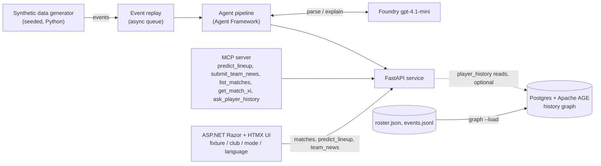
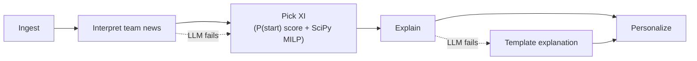
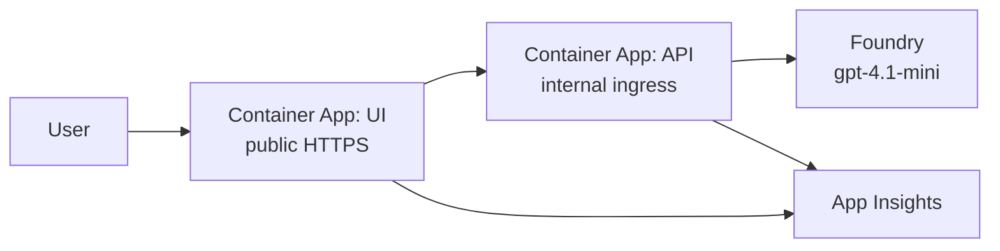

# Architecture

Lineup Oracle predicts a club's starting XI before kick-off. It replays synthetic match and team-news events through a Microsoft Agent Framework pipeline, picks the XI with deterministic code, and uses an LLM only to parse team news and explain the pick.

This file holds the system picture and the contracts between components. Implementation detail lives in each OpenSpec change's `design.md`. Working plan, deadlines and tool allocation are in [PLAN.md](PLAN.md). Any change that alters a contract or component updates this file in the same PR.

Status key: **stable** (built or fixed), **draft** (agreed shape, will change when its OpenSpec change is proposed), **planned** (not built).

## System context



All data is synthetic: invented clubs and players, no crests, logos or photos.

## Pipeline



- **Deterministic:** P(start) is a transparent weighted score, with no trained model: `availability × (0.7 × quality + 0.3 × share of the last 5 matches started)`, where availability is 1 (available), 0.5 (doubt) or 0 (out). The MILP runs once per formation, weighted by the club's formation prior (1.0 for its usual formation, 0.85 for any other), and the best weighted total wins. Ties go to the lower player id.
- **LLM:** only parses free-text team news and writes explanations. If it fails, the XI is still returned, with a template explanation.
- **Team news has two input paths.** Structured events (UI preset buttons) skip the LLM and go straight to availability. Free-text news (generated, or typed in the UI) goes through the LLM parser, which outputs the same structured availability. If the parse fails or names an unknown person, the news is rejected with a message and the XI is unchanged. A typed line that names no status is posted to the shared news instead (see `submit_team_news`).

## Azure deployment (built, not yet deployed live)



Defined in `infra/` (`main.bicep`, `containerApp.bicep`, `main.bicepparam`) and deployed by `infra/deploy.ps1`; images are built in Azure Container Registry from `backend/Dockerfile` and `ui/Dockerfile`. CI (`.github/workflows/ci.yml`) runs `pytest`, `dotnet test` and a Bicep compile; there is no deploy job.

- **Ingress:** only the UI is public (HTTPS). The API has internal ingress, reachable inside the Container Apps environment only; the UI reaches it through `LineupApi__BaseUrl`. Both run one replica, because team news, the news feed and anti-forgery keys are in memory.
- **Identity and secrets:** one user-assigned managed identity, shared by both apps, holds `AcrPull` on the registry and `Cognitive Services OpenAI User` on the Foundry account. The API reaches the model with `DefaultAzureCredential` (`AZURE_CLIENT_ID` selects the identity), so there is no model key and `LINEUP_LLM_API_KEY` is never set. Nothing needs storing as a Container Apps secret. The Foundry account has local (key) auth disabled.
- **Model settings:** `LINEUP_LLM_ENDPOINT` and `LINEUP_LLM_DEPLOYMENT` come from the Bicep outputs. Without Foundry quota, `existingLlmEndpoint` and `existingLlmDeployment` point at a model you already have. If the model is missing or fails, the API still serves XIs with template explanations.
- **MCP:** the MCP adapter is a stdio process and is not hosted. Run it locally with `LINEUP_API_URL` pointing at an API.
- **Telemetry:** OpenTelemetry only, exported through the Azure Monitor distro (`azure-monitor-opentelemetry` in the API, `Azure.Monitor.OpenTelemetry.AspNetCore` in the UI), switched on only when `APPLICATIONINSIGHTS_CONNECTION_STRING` is set (the deployment sets it). The API also calls `agent_framework.observability.enable_instrumentation()`, so the pipeline's built-in traces are exported; prompts and replies are not captured. The distros instrument FastAPI, httpx and ASP.NET Core, which links the UI request to the API request. The traces show per-stage timing and LLM failures with the template fallback serving the XI. Custom spans: two nested under the request span, `lineup.predict` (`POST /predict_lineup`) and `lineup.team_news` (`POST /team_news`). Both carry `match_id` and `club` and, on success, `mode`, `language`, `formation` and `llm_used` (false when the template fallback wrote the explanations); predict adds `lineup.source` (`stored` or `personal`), team news adds `news.input` (`text` or `structured`) `news.kind` and, for text, `news.outcome` (`applied` or `posted`). A rejected news request marks its span as an error. When the model wrote the explanations, both spans also carry `explanation.grounded_ratio` and `explanation.failed_rules` (the grounding check, observe only: the response never changes). The shared feed records a root span `news.step` per delivered item with `match_id`, `club`, `news.applied` and `news.parse_correct` (the parser's answer compared with the event's labels after the parse). Prompts, replies, explanations and session ids are never recorded. No custom metrics, events or dashboards.

## Contracts

### Event schema (stable)

One flat JSON object per event, JSON Lines on disk:

| Field | Type | Notes |
|---|---|---|
| `id` | string | unique |
| `match_id` | string | |
| `type` | string | pass, shot, tackle, possession_change, pressure, team_news (injury, suspension, late fitness doubt), match_metadata |
| `minute` | float | match minute; team news uses offsets before kick-off |
| `club` | string | |
| `player` | string or null | null for non-player events |
| `payload` | object | type-specific |
| `simulated` | bool | always true |

Generated team-news events are free text in `payload.text` (English, naming the club and player, with `player` null), so the LLM parser must read them. `payload.translations` holds the same news in Spanish (`es`) and Traditional Chinese (`zh-Hant`), from templates aligned with the English ones, so it is deterministic and needs no model call; the parser never reads it. The API rejects a stored events file whose team news lacks `payload.text` or either translation, telling the operator to regenerate it. The payload also carries `kind` and `player_name` as answer labels for the parser eval; the parser must not read them. The feed reads them only after the parse, to record `news.parse_correct` on its span. Events with structured fields only (UI preset buttons) skip the LLM. The structured truth is the true XI in the match metadata.

Match metadata records the actual starting XI and formation of both clubs, `payload.matchday` (1 to 10) and `payload.schema_version` (1). Event minutes are relative to each match's kick-off, so replay one match at a time. Source: `openspec/changes/synthetic-data-and-replay/design.md`.

### `predict_lineup` (stable)

`POST /predict_lineup` with `{match_id, club, mode, language, session_id}`. `session_id` is optional (default `"default"`, at most 64 characters): team news is kept per session, so visitors using the same deployment do not see each other's news. The UI sends one id per browser. `mode` is `analyst` or `fan` (default analyst); `language` is `en`, `es` or `zh-Hant` (default en); both are validated and echoed. `language` and `mode` shape only the explanation texts (the XI is the same). The club must play in the match.
Response: `formation`; `players` (11, each with `id`, `name`, `number`, `position`, `p_start`, `status` (`available`, `doubt` or `out`), `explanation`); `alternatives` (up to 2 per position in total, same player shape; see `alternatives` below); `candidates` (non-starters whose latest effective news is an injury, doubt or suspension, each with `id`, `name`, `number`, `position`, `kind` and `included`, true only while the player is shown in the alternatives as a manual selection; a suspended candidate is listed but never selectable, and a suspension ends only with a text "cleared" status, so other news for that player is rejected with 422 and a later feed event does not replace it); `llm_used` (true when the explanation texts came from the model, one flag per lineup); `mode`; `language`. The prediction uses only the club's XIs from earlier matchdays plus the availability submitted for that match and club, never the match's own XI. Explanations come from the LLM explainer in the requested mode and language; if the model is off, fails or returns something invalid, they are English templates and `llm_used` is false. Fan texts never contain numbers, `%` or "P(start)".
Errors: `{"detail": message}` with 404 for an unknown match and 422 for a club not in the match, a bad mode or language, or when no formation can be filled.

### `alternatives` (stable)

`POST /alternatives` with the predict fields plus `player_id` and `included`. It puts a non-starting injured or doubtful player of the club in the alternatives for their position (`included: true`) or takes them out (`false`), for that session, match and club only, and returns the updated `LineupOut`. It sets state, so repeating a request changes nothing, and it never changes a player's availability or the XI (it is not team news and is not an MCP tool). 404 for an unknown match; 422 for a club outside the match, a player outside the club, a starter, or a player with no injury or doubt news (suspended players included); a removal is always accepted. Per position at most 2 alternatives are returned in total: natural alternatives (the top 2 by P(start) among non-out players) fill the slots, a selected player takes a slot from the lowest-ranked natural one, and if more than 2 are selected the 2 latest take priority. Natural entries are listed in rank order, then selections oldest first. Selections are filtered on every read (a player who is suspended, recovered or promoted into the XI disappears at once) and the invalid ones are discarded at that session's next selection change. They are kept in memory per `(session_id, match_id, club)` and lost on restart. A selection-only session still reads the stored prediction and overlays it on a copy.

### `submit_team_news` (stable)

`POST /team_news` with the predict fields plus `player_id` and `kind` (`injury`, `suspension` or `doubt`). Injury and suspension mark the player out, doubt marks the player doubt, for that match, club and session only; the latest news for a player wins. The response is the updated `LineupOut` (same shape as `predict_lineup`). The structured path is what the UI preset buttons use. A request with `text` (at most 100 characters, else 422) and no player and kind goes to the LLM parser (`Pipeline.read`), which lists the persons named, the club named if any, an optional status (the three above plus `recovered`, `cleared` and `fit`, which mark the player available and override an earlier out or doubt) and the line in English, Spanish and Traditional Chinese. Code, not the model, resolves each person by full name in the selected club, then the other club of the match, then any club. Outcomes: one player with a status is applied to that player's club (which must play in the match) for the session only, as on the structured path; one player without a status, or no person but a known club, is posted to the shared news log as an `info` entry with all three texts (each non-empty and at most 200 characters, else rejected) and changes no lineup; an unknown person (including an outsider), two players, a status for a club outside the match, no person and no club, a model that is off, fails or times out, or an unreadable answer is rejected with 422 and nothing changes. The response carries `news: {outcome: "applied" | "posted", club, player_name, kind}` (null on the structured path), and the lineup is the requested club's. A session may post one line every 10 seconds (429 otherwise, in memory per session); applying a status or a rejection does not count. A player outside the club, an unknown match or a bad kind is rejected with no state change. Availability lives in memory and is lost on restart.

### News feed (stable)

One shared feed runs inside the API from its start (a daemon thread started by the FastAPI lifespan, so a `TestClient` without lifespan has none). It holds the team-news events of matchday 1 (3 matches, 6 clubs, at most 18 items) ordered by (minute, match id, event id), and delivers one every `FEED_INTERVAL` = 15 seconds from a fixed schedule (a slow item is followed by the next one, never a burst). Per item the feed asks the LLM parser once (`Pipeline.interpret`), updates the shared availability for that match and club, picks the XI once and stores it in memory; no visitor, poll or lineup request repeats any of that. An item that cannot be read, names a player outside the club, leaves no legal XI or raises is logged as not applied and changes nothing. Without a configured model every item is not applied.

The feed keeps a numbered log of the last 50 entries (`seq` never decreases, including across resets): `{seq, kind: "news" | "restart" | "info", match_id, club, text, applied}`; `info` is a line posted by a visitor (`applied` false, no effect on availability or predictions, kept across resets until it leaves the window). After the last item the feed waits one interval, resets the shared availability and stored XIs to the baseline, logs a `restart` marker and starts again. The automatic reset never removes a visitor's personal news; a manual restart clears every session's personal news and alternatives.

- `GET /news?since=&match_id=&club=&language=` returns `{items, latest_seq, changed}`: the entries newer than `since` (all retained entries without it), each with only the text of `language` (`en`, `es` or `zh-Hant`, default `en`, anything else is 422) in its `text` field (a restart marker has empty text; the log keeps all three texts), and `changed`, true when a new applied item is for that match and club or a restart marker is new; an `info` entry never sets it (always false without `since`). It only reads the log.
- `POST /news/restart` resets (also clearing every session's personal news and alternatives), logs a marker, delivers item 1 at once (one model call in the request) and returns `{latest_seq}`. Any caller may use it; there is no stop.

`POST /predict_lineup` applies the shared availability together with the session's own news per player, the larger `seq` winning (a tie goes to the session's own entry). A session with no news of its own for the match and club reads the stored XI (picked once from the shared availability if absent). Personal news and the shared availability are stored as `(kind, seq)` (`injury`, `suspension` or `doubt`; the status `out` or `doubt` is derived from the kind, so an injury stays distinct from a suspension) where `seq` is the feed's latest number when it was submitted. `ReplaySession` is not used by the feed. The state is in memory and the API must stay at one replica, or each replica would run its own feed.

### Read-only operations (stable)

`GET /matches` returns `[{match_id, matchday, home_club, away_club}]` in matchday order. `GET /matches/{match_id}/xi` returns the recorded XI and formation of both clubs (404 for an unknown match). `GET /health` returns `{"status": "ok"}`. Run with `uvicorn lineup_oracle.api:create_app --factory`.

### MCP server (stable)

A thin adapter over the FastAPI service with no logic of its own (`lineup_oracle/mcp_server.py`, stdio transport). Tools: `predict_lineup`, `submit_team_news` (same contracts as above), `list_matches` and `get_match_xi` (read-only), and `ask_player_history` (a pass-through of `POST /player_history`: either a `question`, or a `player` with optional `types`, `start`, `end` and `match_id`). Each tool is one HTTP call to `LINEUP_API_URL` (default `http://127.0.0.1:8000`), and API errors come back as tool errors carrying the API's message. Any MCP client, such as GitHub Copilot or Claude Desktop, can submit structured team news and read the new XI; free text works when the model is configured (otherwise `submit_team_news` returns the API's 422 message). The agent pipeline does not call MCP. It is the first thing cut after Azure polish if time runs short.

### `player_history` (stable)

`POST /player_history` with exactly one of `question` (at most 300 characters) or `filters` `{player, types?, from?, to?, match?}`; neither or both is 422. `player` is a player id or an exact name (an ambiguous name is rejected with the candidate ids, an unknown one with its name); `types` is a subset of `shot`, `tackle`, `team_news` and `started` (null means all); `from` and `to` are inclusive ISO 8601 times (naive means UTC); `match` is a match id. The response is `{filters, events, answer, cited_event_ids, llm_used}`: `filters` are the filters used (player resolved to its id, times in UTC), `events` are `{id, type, match_id, club, occurred_at, payload}` in time then id order, and every error is `422 {"detail": message}`.

- **What is history:** shots, tackles and team news (linked to a player by `payload.player_name` within the club; a name that matches nobody, or two players of one club with one name, is an error naming the event) and one `started` item per match the player was in the true XI. Passes, pressure and possession changes are not history. A `started` item has the id `<match_id>-start-<player_id>` and sits at the match's kickoff.
- **Times (the kickoff rule):** the events file has no timestamps. `kickoff_at = 2026-08-15T15:00Z + 7 days × (matchday - 1)`; `occurred_at = kickoff + minute` minutes, except team news, whose offsets (48, 24, 1) are hours before kickoff. Times are kept to the millisecond and printed as `…T15:00:00.000Z`. The constant lives in `lineup_oracle/history.py`.
- **Question path:** the model (`Pipeline.parse_history_question`) reads the question into `{player, types, from, to, match}`, given the matchday kickoff table, and code validates every part (a player that resolves, known types, parseable and ordered times, a known match) or answers 422. With the model off, a question is 422 asking for explicit filters. Explicit filters never call the model to parse.
- **Answer path:** the model (`Pipeline.answer_history`) gets only the retrieved events (the newest 100, oldest first) and returns an answer with `cited_event_ids`. If it is off, fails, returns nothing, or cites an id it was not given, the response carries a deterministic template summary citing every retrieved event, with `llm_used` false. No events retrieved means the template "Nothing found" answer and no citations, with no model call. An explicit-filters request never fails because of the model.
- **Graph or memory:** one retrieval, two implementations. In memory (`history_from_memory`) it scans the loaded events and is the reference. With `LINEUP_PG_URL` set it runs two fixed, parameterised Cypher queries on the Postgres + Apache AGE graph (`lineup_oracle/graph.py`); any `psycopg.Error` (connect timeout 2 s, statement timeout 5 s) falls back to memory for that request with a log line. Both return identical rows (a parity test checks it). Player resolution and filter validation always run in memory, so user text never reaches Cypher text.
- **The graph is a derived index, read-only for the API.** Vertices `Club{name, formation}`, `Player{id, name, position, number}`, `Match{id, matchday, kickoff_at}`, `Event{id, type, minute, occurred_at, payload}`; edges `PLAYS_FOR`, `HOME_IN`, `AWAY_IN`, `STARTED`, `HAD` (player to event) and `IN` (event to match). `python -m lineup_oracle.graph --load` drops and rebuilds it from the files in one transaction (about 10 s; a failed load keeps the old graph). The API never connects at startup, so a down database cannot stop it, and predictions, team news and match reads never touch it.

### UI (stable)

The ASP.NET Razor Pages + HTMX app is a single page and calls only the FastAPI service. It loads fixtures from `GET /matches`, predicts with `POST /predict_lineup`, and submits preset or typed team news with `POST /team_news`. In analyst mode it lists each position's eligible injured or doubtful players with an add or remove action that calls `POST /alternatives` and swaps only the lineup fragment; fan mode shows the alternatives and their status without controls. Preset injury, suspension and doubt updates are supported; typed news (box limited to 100 characters) goes to the LLM parser when the model is configured, otherwise the API rejects it with 422. After a submission the page says whether a player's status was updated (naming the club when it is not the selected one) or the line was posted to the news feed; rejections show under the box. Each browser gets a random `session_id`; the UI sends it, the selected mode and language with prediction and news requests. Mode, language and favourite club are presentation preferences stored in cookies. The UI owns presentation only; it does not score players, choose formations, or keep availability state.

Same-page actions that update the current view use HTMX requests and server-rendered HTML fragments by default. This applies to fixture and club selection, favourite-club and language preferences, team-news submissions, and retry. Successful fixture, club, and favourite changes replace the shared workspace and push the selected match and club into browser history; language changes replace the localized application shell. A failed selection keeps the last successful workspace visible and offers retry for the requested selection.

An optional **player-history chat panel** sits under Team news, rendered only when the UI setting `PlayerHistory:Enabled` is true (default false; true in Development). It is single-turn: `POST /?handler=History` sends only `{question}` (box limited to 300 characters) to `POST /player_history` and shows the question and the answer (Template or AI marker, collapsible event list), replacing the previous pair so only one exchange is kept, or an inline error for a 422 or an outage, never touching the lineup. The panel carries `hx-preserve` and an id that includes the language, so the exchange survives `#workspace` swaps and is cleared by a language change. The handler answers 404 when the setting is off. Answers are shown as the API returns them (English).

A shared news ticker (`#news-bar`) sits above the busy status. It polls `GET /?handler=News` every 10 seconds (`News:PollSeconds`) with the last-seen `seq`, the displayed match and club and the page language, so each message shows in the visitor's language (the restart follow-up read uses it too); the poll has its own hidden indicator, so it never shows the busy status, and answers 204 (no swap) when nothing is new or the API is down. Each new entry is appended as its own element with its own right-to-left CSS animation, so entries already on screen never restart. `news.js` holds new entries offscreen in a client-side queue and releases them one at a time at one constant speed (80 px/s): the next starts once the previous has cleared the entrance and at least 3 seconds after it, with no per-entry CSS delay. More than 5 waiting entries drop the oldest, except a restart marker; a restart marker and the item delivered with it are one entry; feed items that were not applied carry a text mark, while a posted line (`info`) does not and never triggers a refresh; under reduced motion the entries are a static list. When the API reports that the displayed club changed (or the feed restarted), the response carries `HX-Trigger: lineup-changed` and `#workspace` fetches the lineup again without touching history. Selection and language responses carry a fresh bar with no last-seen number, so older news cannot trigger a refresh. The Restart feed button posts `/?handler=RestartFeed` and, as a user action, shows the busy status. While any in-page HTMX request is pending, a shared localized status is shown and politely announced; the existing view remains visible until the response is applied. Its spinner is indeterminate and respects reduced-motion preferences; no completion percentage is shown. Non-HTMX form submissions retain full-page behavior. True document navigation, such as the brand link, and file downloads remain normal browser requests. Future in-page UI features follow this convention.

```text
+--------------------------------------------------------------------------------+
| LINEUP ORACLE                                                Language: [en v] |
| [News ticker, right to left: shared items]                  [Restart feed]     |
| [Updating... status, shown during pending HTMX requests]                          |
| [Service unavailable banner: retry]                                            |
+--------------------------------------+-----------------------------------------+
| FIXTURES                             | LINEUP                                  |
| [Matchday / fixture picker]          | Formation: API value    [Template / AI]|
| [Club toggle: Home | Away] [star]    |                                         |
|                                      | Forwards                                |
| TEAM NEWS                            | [Player card] [Player card] ...         |
| [Free-text news input] [Submit]      | Alternatives: API values                |
| [message / API error]                |                                         |
|                                      | Midfielders                             |
|                                      | [Player cards]                          |
|                                      | Alternatives: API values                |
|                                      |                                         |
|                                      | Defenders                               |
|                                      | [Player cards]                          |
|                                      | Alternatives: API values                |
|                                      |                                         |
|                                      | Goalkeeper                             |
|                                      | [Player card]                           |
|                                      | Alternatives: API values                |
+--------------------------------------+-----------------------------------------+
```

Each player card has text-only name, shirt number, position and explanation, plus preset injury, suspension and doubt buttons. The UI always runs in analyst mode and shows API `p_start` values. The mode switch is hidden to keep the demo simple; the API and `/?mode=fan` still support fan mode, which hides them. The last lineup stays visible when an API error occurs. There are no crests, logos, photos, invented metrics, or panels for data the API does not return.

### Pipeline stages (stable)

Implemented in `lineup_oracle/pipeline.py` (a deterministic orchestrator) with two Microsoft Agent Framework agents in `agents.py` (News Parser, Explainer). Model settings are environment variables, or entries in a `.env` file found from the working directory upward (real variables win): `LINEUP_LLM_ENDPOINT` and `LINEUP_LLM_DEPLOYMENT` (both needed to turn the model on), optional `LINEUP_LLM_API_KEY` (else `DefaultAzureCredential`) and `LINEUP_LLM_TIMEOUT` (seconds, default 15). The model never picks the XI; code validates every model answer.

| Stage | In | Out |
|---|---|---|
| Ingest | the shared news feed (`ingest.py`): matchday-1 team-news events, one every 15 s | one parse and one pick per item, stored in memory as shared availability and a stored XI per match and club |
| Interpret | structured team-news events (built), or free-text news via the LLM parser (built) | availability per player (or rejection) |
| Pick XI | availability, roster, form | formation + 11 players with `p_start`, and up to 2 alternatives per position |
| Explain | picked XI facts | explanation per player (one batched model call, template fallback) |
| Personalize | explanations, mode, language, favourite club | final response |

## Evaluation

Correct starters out of 11 versus a "same XI as last match" baseline, on held-out synthetic matches (matchday 3 on). It shows the pipeline works, not real-world accuracy. `python -m lineup_oracle.evals` prints the lineup score; it also prints the share of template explanations grounded in their facts (always 100%). With `--parser` and a configured model it scores the news parser (text and club in, player and kind out); with `--explanations` (and `--mode`, `--language`) it scores the model's explanations. Grounding is rule-based, with no model as judge: every number must be one of the player's starts, played or `p_start`, a doubtful player must be described as a doubt and a fit one not as doubtful, injured or suspended, no teammate is named, and fan mode has no percentage. Numbers written as words are not read. Seed 42: pipeline 7.79 / 11 versus baseline 6.58 / 11 over 48 club-matches.

## Open decisions

- **Event Hubs instead of the in-process queue:** cut unless time allows. Owner: user. Decide by Oct 25 feature freeze.
- **Persistence:** none for the XI path. Roster and events are files and availability is in memory. Player history may use an optional, read-only Postgres + Apache AGE graph, a derived index of those files (`player-history-graph-rag`). This reverses the Oct 20 note "Postgres was cut", for history only: with the database absent or down, `player_history` answers from memory and nothing else changes.
- ~~Formation-to-MILP mapping and formation priors~~ Decided in `pstart-scoring-and-xi-optimizer`: one MILP per supported formation (1 GK, DEF, MID, FWD counts, middle bands as midfield), priors 1.0 / 0.85.
- **Theme fit of a pre-match predictor:** decided not to ask the sponsor; accepted risk.
